# BlackMusic

**BlackMusic** is a music player for Windows, macOS and Linux (with Android and iOS builds from the same code). It plays the music already on your computer and the services you already use, side by side, in one app, and every online feature stays opt-in.

## Downloads

Get BlackMusic from the following distribution channels:

GitHub Releases is the primary source. **Settings → Updates** checks it and installs new versions in place.

## Screenshots

**Desktop**

| Home | Playground |
|:---:|:---:|
| 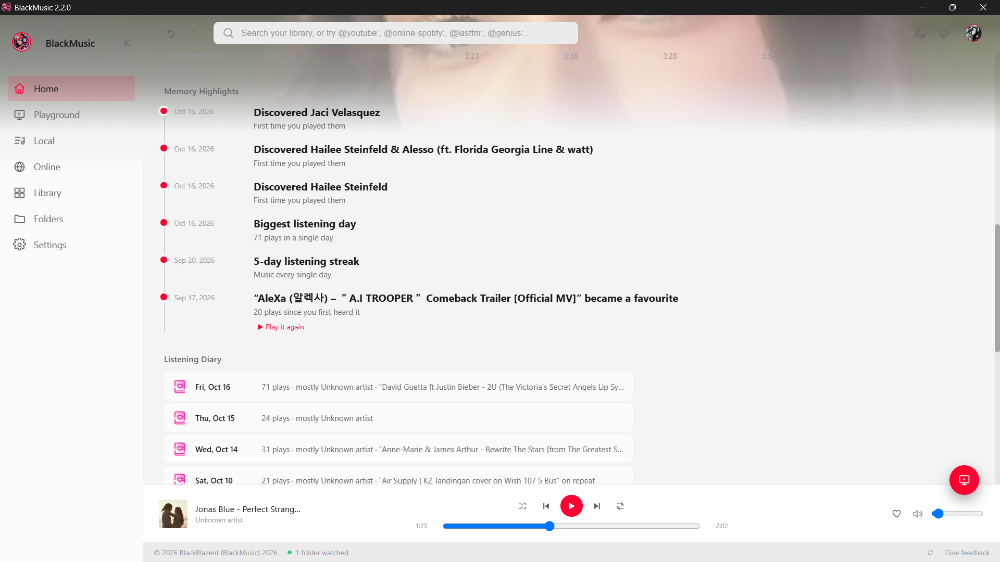 | 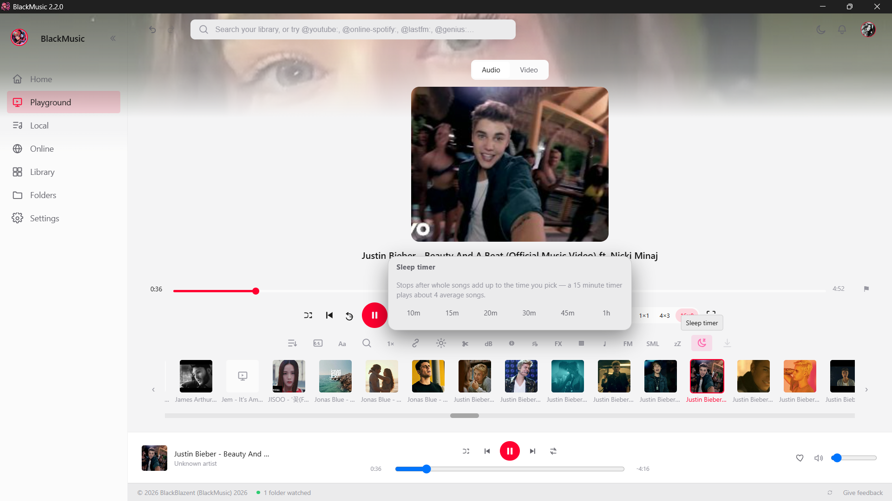 |
| **Local Music** | **Online Music** |
| 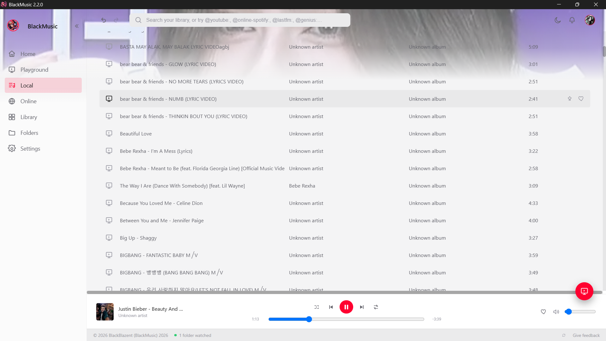 | 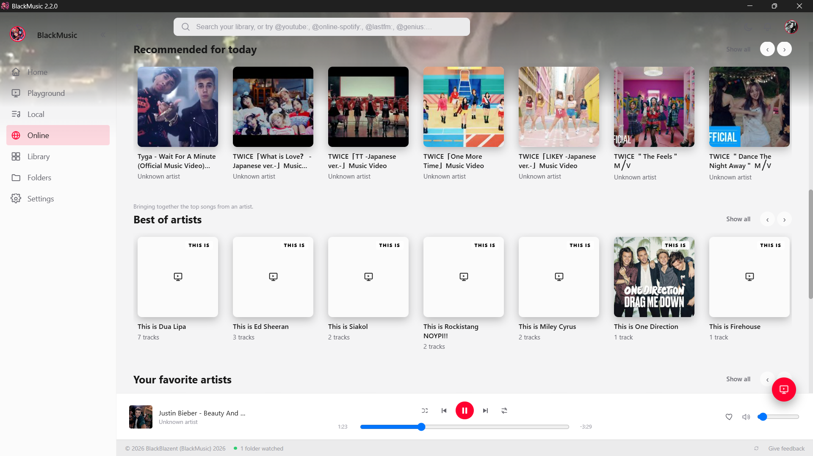 |
| **Library** | **Settings** |
| 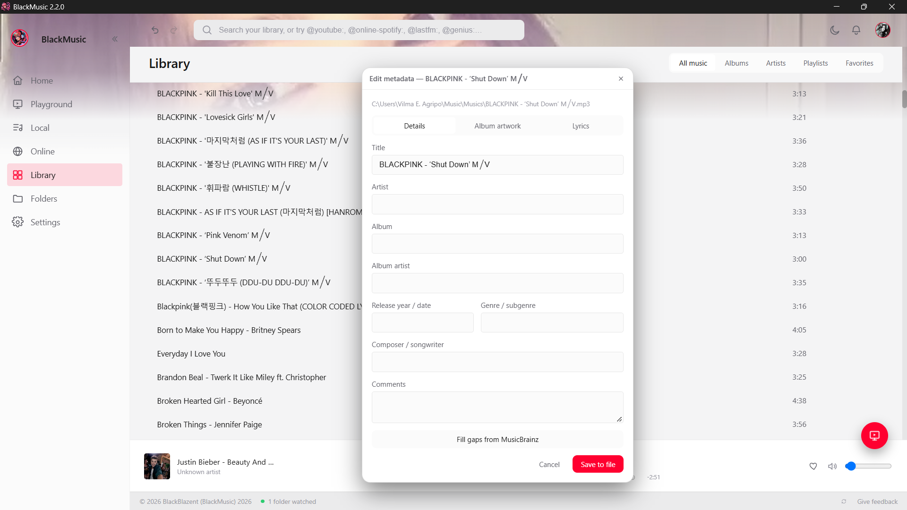 | 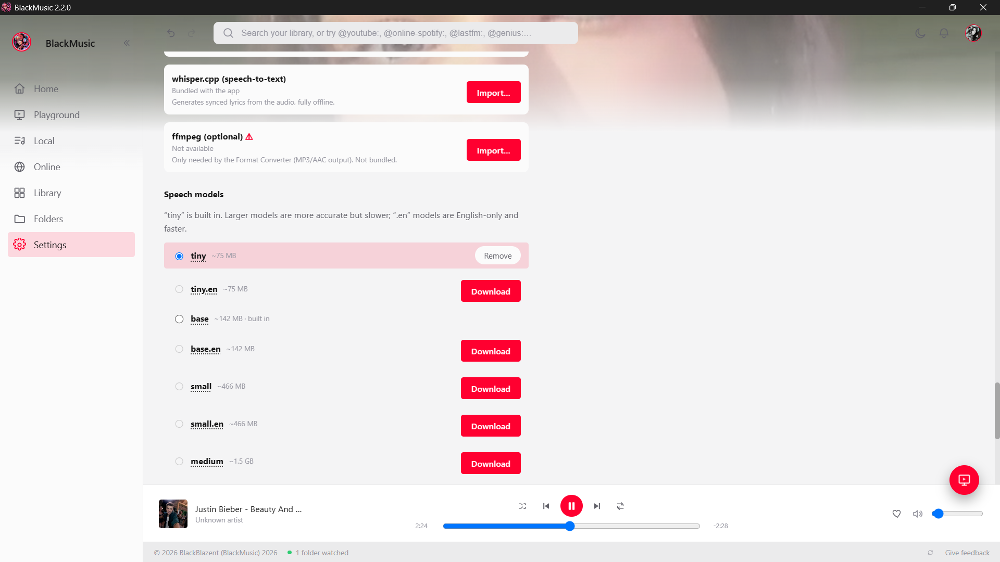 |

**Mobile**

| Home | Playground |
|:---:|:---:|
| 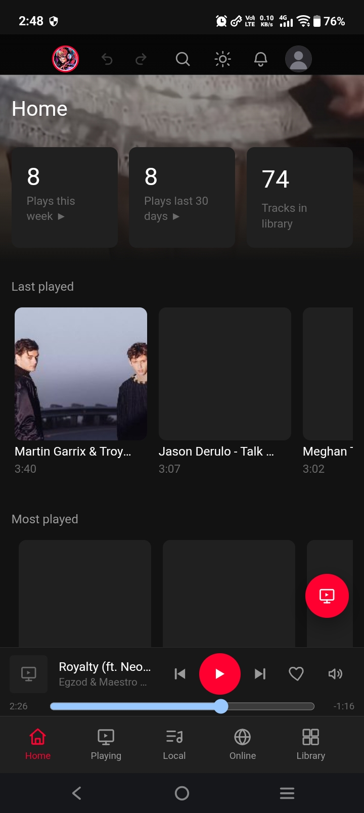 | 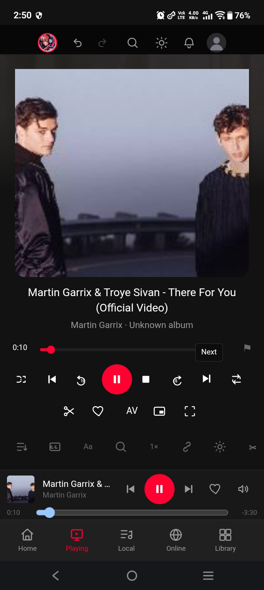 |
| **Local Music** | **Online Music** |
| 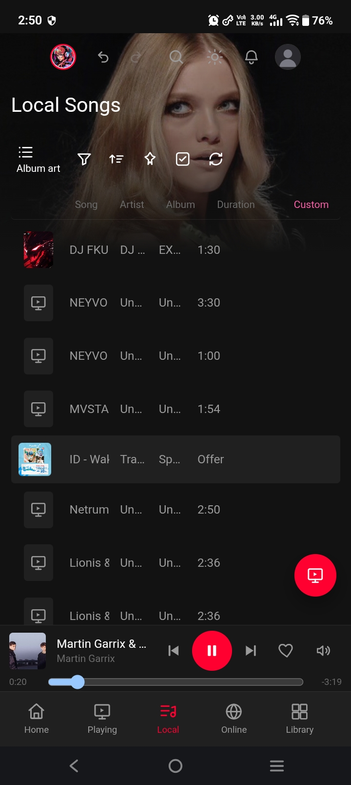 | 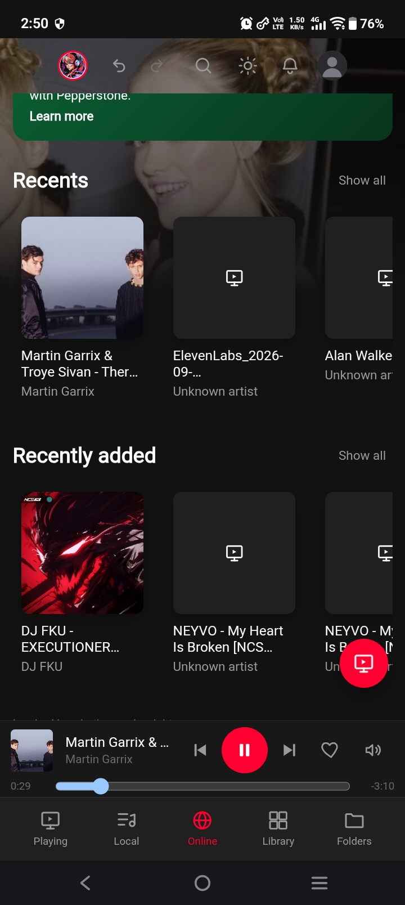 |
| **Library** | **Settings** |
| 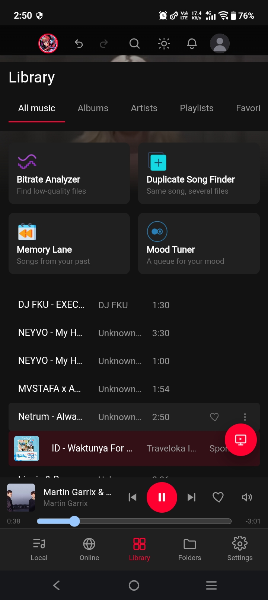 | 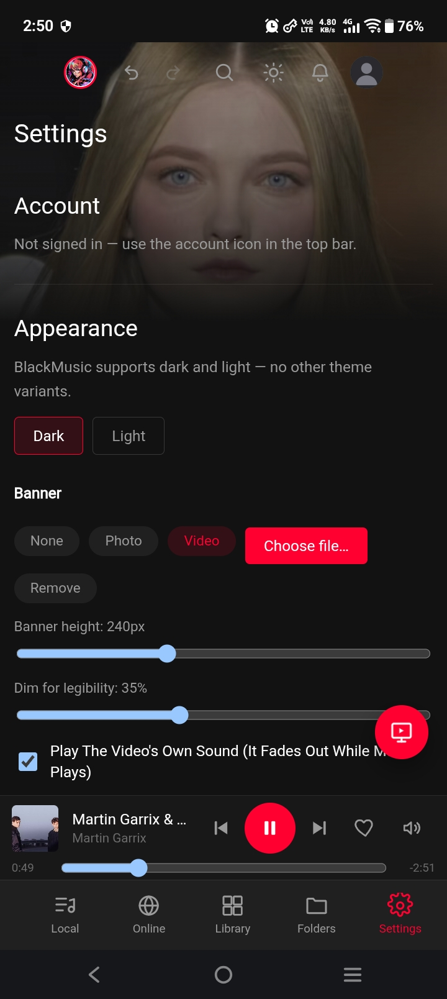 |

## What it does

* **Plays your own library.** Point it at the folders where your music lives and it keeps them in sync. Adding a folder scans only that folder, and nothing is re-imported each time you open the app. On Android, your device's music folders are discovered automatically.

* **Brings services in alongside your files, not instead of them.** Connect a service from the logo in the sidebar and switch between "my files" and "my Spotify" without leaving the app. Online pages use the same browse layout for every service: shelves of recents, stations, best-of lists and favorite artists.

* **Searches everywhere from one box.** Plain text searches your library. Prefixes reach further: `@youtube:`, `@online-spotify:` (or any service), `@lastfm:`, `@musicbrainz:`, `@genius:`, and `@page:` to jump to a page.

* **Keeps one now-playing bar on every page**, with a shortcut back to the full player.

* **Has a full "theater" view (Playground).** Album art, synced and karaoke-style lyrics, a loop creator, timeline markers, focus zones for practicing a section, an audio cutter, visualizers, and sound tools such as a pitch shifter, filters, a volume normalizer and live tempo/key/energy readouts.

* **Makes lyrics work offline.** Lyrics come from public sources when available. When they aren't, BlackMusic can transcribe a local track on your computer with built-in speech recognition (whisper.cpp), with no upload.

* **Looks after your files.** Edit tags and embedded artwork (title, artist, album, album artist, year, genre, composer, comments, lyrics), fix many tracks at once, and find low-bitrate files and duplicates. Smart playlists fill themselves from rules such as "most skipped" or "never played".

* **Opens files from your system.** Choose "Open with BlackMusic" on supported audio and video files, including several at once.

* **Looks the way you want.** Add a banner photo or video, pin a dock to any screen edge, enable a visualizer screensaver, and choose from English, Deutsch, 日本語, Português (Brasil), English (India), हिन्दी, Français and Español.

## Platforms

* **Windows, macOS, Linux:** installers are on GitHub Releases.
* **Android and iOS:** built from the same code. See **[MOBILE.md](MOBILE.md)**. Mobile uses a bottom navigation bar, and desktop-only tools such as the mini player, dock mode and the bundled tools are hidden.

## Using it

* **Folders:** add the folders where your music lives. A strip shows the subfolders inside the one you are browsing. Removing a folder removes its tracks from the app, never from your disk.
* **Local:** every track in your watched folders, sortable and filterable.
* **Library:** your music by album, artist, playlist or favorites, plus the maintenance tools (bitrate analyzer, duplicate finder, batch tag editor, format converter and more).
* **Online:** pick a connected service from the sidebar logo and browse its content, or switch to the list view.
* **Home:** your recent listening, plus "play this week", "play the last 30 days", a highlights timeline and a listening diary.
* **Playground:** the full-screen player, with tools opening as floating panels so nothing resizes beneath you.
* **Settings:** appearance and banner, personalization, language, integrations and API keys, plugins and tools, account, and updates.

## Bundled tools

BlackMusic ships with **yt-dlp** (plays and searches YouTube-based sources) and **whisper.cpp** (offline lyrics). **Settings → Plugins & Tools** lets you update or replace yt-dlp and download or import larger speech models. The format converter additionally needs **ffmpeg**, which is not bundled. Download only content you have the right to download.

## Good to know

* **Spotify playback needs Spotify Premium.** Free accounts can sign in but cannot use Spotify's Web Playback SDK. That restriction is Spotify's, not BlackMusic's. Apps in Spotify's development mode also only serve accounts on the app's allow-list.
* **Some services list music without streaming it** (Last.fm, MusicBrainz, Tidal). BlackMusic finds a playable source when you click a track. If only a short preview exists, it says so.
* **Third-party services are opt-in.** Nothing you play is sent to a service you haven't connected or used. YouTube, Last.fm, MusicBrainz and Genius only make requests when you search them, play from them or enable them in Settings. MusicBrainz needs no key. Last.fm and Genius use free keys you provide.
* **File associations register BlackMusic as an option, not as your default.** You choose the default app in your system settings.

## Building from source

See **[DEVELOPMENT.md](DEVELOPMENT.md)** for setup and build instructions on Windows, macOS and Linux, and **[MOBILE.md](MOBILE.md)** for Android and iOS.

## License

BlackMusic is released under the **BlackBlazent License**. See the [LICENSE](LICENSE) file for the complete terms.