<!--
  BlackMusic landing page. Layout: hero, short intro, then one block per section: title (with icon) -> banner -> short text -> link.
  Artwork: docs/assets/banners/*.svg and docs/assets/icons/*.svg (regenerate with `node scripts/generate-readme-assets.mjs`).
  Every statement here is checked against the source; planned work is labelled as planned. Real screenshots live in public/assets/media/images/screenshots/.
  Note: GitHub strips inline style="" and target="". HTML comments are public in the raw file — keep them clean.
-->


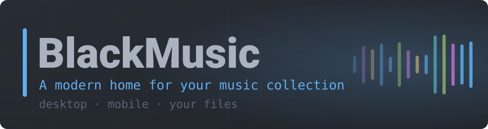


# BlackMusic

**BlackMusic is a music player for the music you already own and the services you already use, together in one app.** It runs on Windows, macOS and Linux, with Android and iOS builds from the same code, and every online feature is opt-in.

<a href="https://github.com/BlackBlazent/BlackMusic/releases"></a>
<a href="https://github.com/BlackBlazent/BlackMusic/releases"></a>
<a href="./LICENSE"></a>

&nbsp;

[](https://github.com/BlackBlazent/BlackMusic/actions/workflows/release.yml) [](https://github.com/BlackBlazent/BlackMusic/actions/workflows/mobile.yml) [](https://github.com/BlackBlazent/BlackMusic/actions/workflows/build-appletv.yml) [](https://github.com/BlackBlazent/BlackMusic/actions/workflows/dependabot/dependabot-updates)

## Now

| | |
| :-- | :-- |
| **Current** | **3.0.0**, a stability and cross-platform update (see [Status](#status)) |
| **Latest release** | [GitHub Releases](https://github.com/BlackBlazent/BlackMusic/releases) |
| **Desktop** | Windows, macOS, Linux |
| **Mobile** | Android and iOS, built from the same code ([MOBILE.md](./MOBILE.md)) |

&nbsp;

## Screenshots

**Desktop**

| Home | Playground |
|:---:|:---:|
| 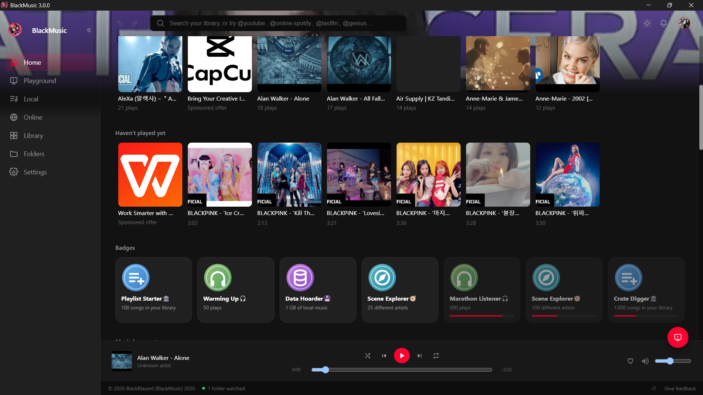 | 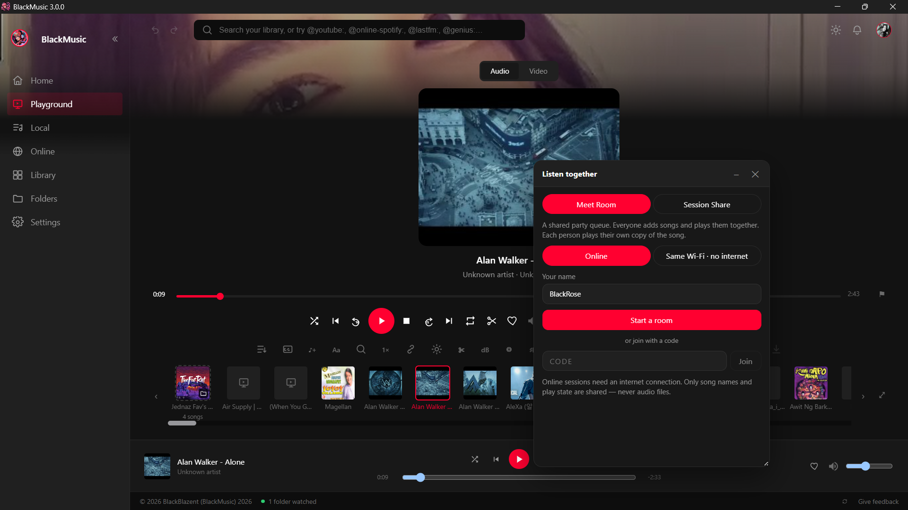 |
| **Local Music** | **Online Music** |
| 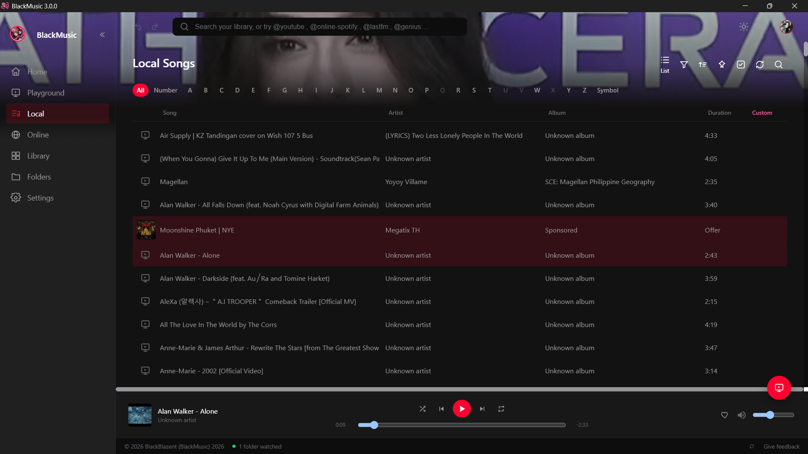 | 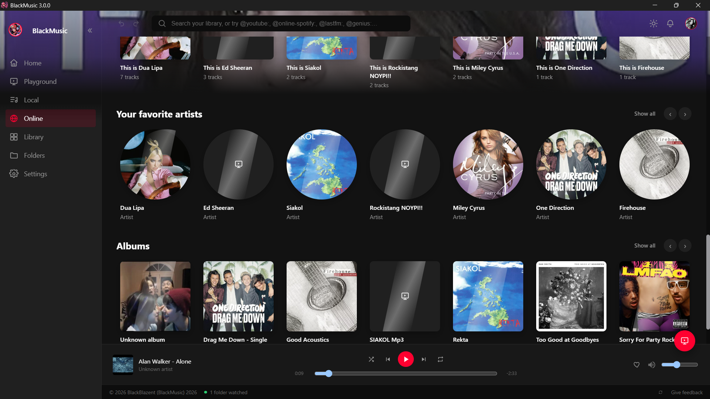 |
| **Library** | **Settings** |
| 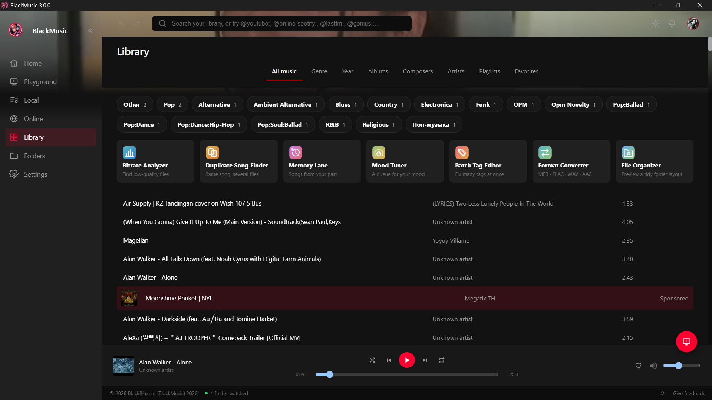 | 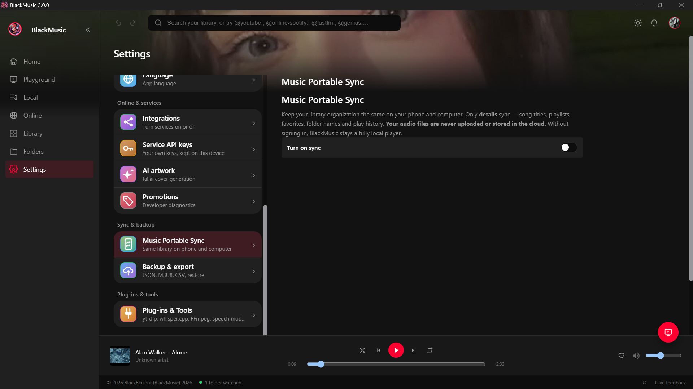 |

**Mobile**

| Home | Playground |
|:---:|:---:|
| 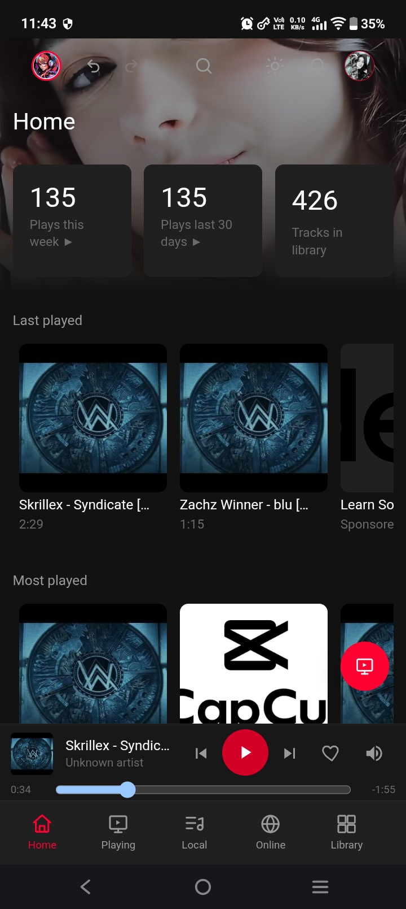 | 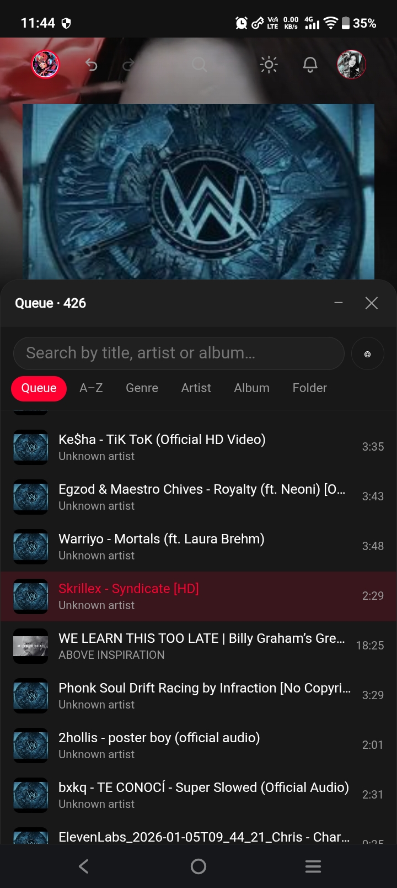 |
| **Local Music** | **Online Music** |
| 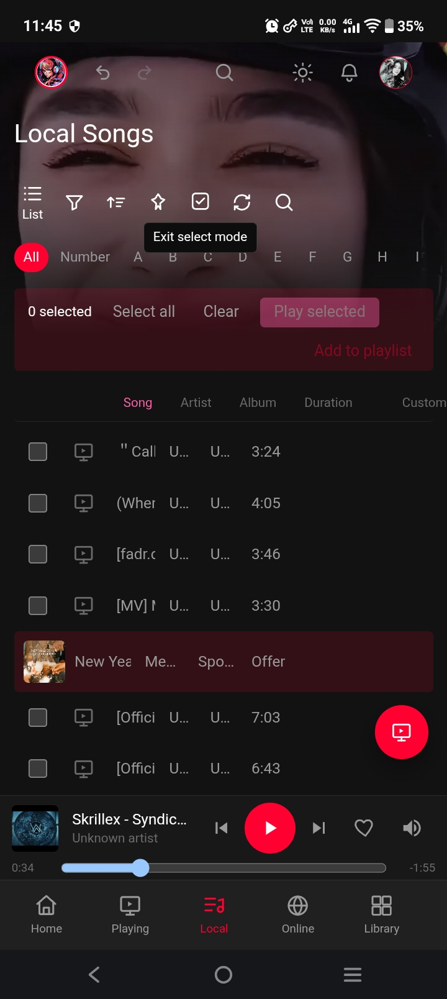 | 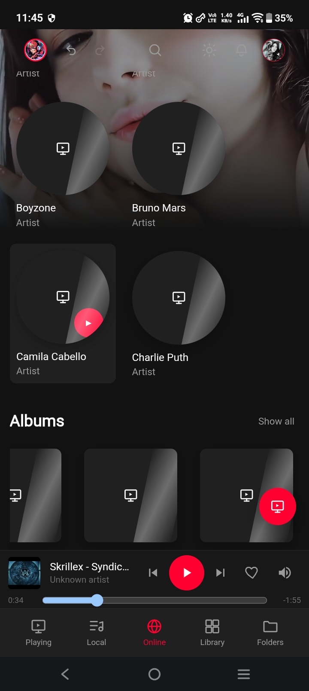 |
| **Library** | **Settings** |
| 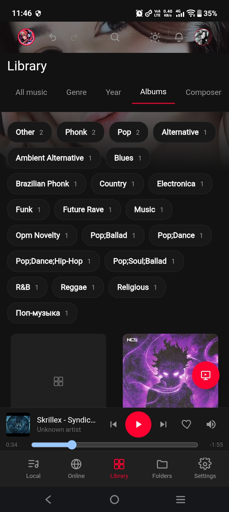 | 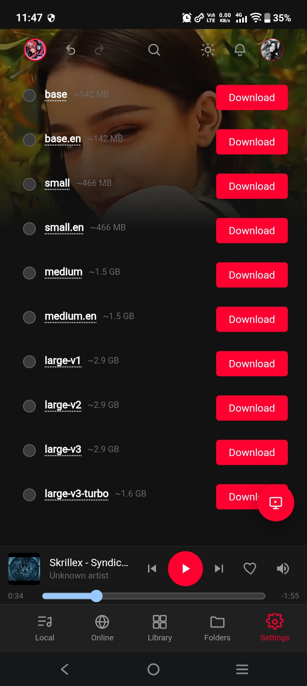 |

<!-- A short screen recording of the Playground would help here: add docs/assets/demo.gif (under 5 MB) and reference it with a descriptive alt text. -->

&nbsp;

##  Features

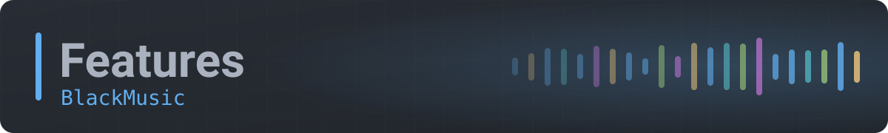

BlackMusic keeps your own library and your online services side by side, without making you give up either.

* **Plays your own library.** Point it at the folders where your music lives and it keeps them in sync. Adding a folder scans only that folder, and nothing is re-imported each time you open the app. On Android, your device's music folders are discovered automatically.
* **Brings services in alongside your files, not instead of them.** Connect a service from the logo in the sidebar and switch between "my files" and "my Spotify" without leaving the app.
* **Searches everywhere from one box.** Plain text searches your library. Prefixes reach further: `@youtube:`, `@online-spotify:` (or any service), `@lastfm:`, `@musicbrainz:`, `@genius:`, and `@page:` to jump to a page.
* **One now-playing bar on every page**, with a shortcut back to the full player.
* **A full "theater" view (Playground).** Album art, synced and karaoke-style lyrics, a loop creator, timeline markers, focus zones for practicing a section, an audio cutter, visualizers, and sound tools such as a pitch shifter, filters, a volume normalizer and live tempo/key/energy readouts.
* **Lyrics that work offline.** Lyrics come from public sources when available. When they aren't, BlackMusic can transcribe a local track on your computer with built-in speech recognition (whisper.cpp), with no upload.
* **Looks after your files.** Edit tags and embedded artwork, fix many tracks at once, find low-bitrate files and duplicates. Smart playlists fill themselves from rules such as "most skipped" or "never played".
* **Opens files from your system.** Choose "Open with BlackMusic" on supported audio and video files, including several at once.
* **Looks the way you want.** Banner photo or video, a dock on any screen edge, a visualizer screensaver, and eight interface languages (English, Deutsch, 日本語, Português (Brasil), English (India), हिन्दी, Français, Español).

[Read how each page works →](#using-it)

&nbsp;

##  Quick start

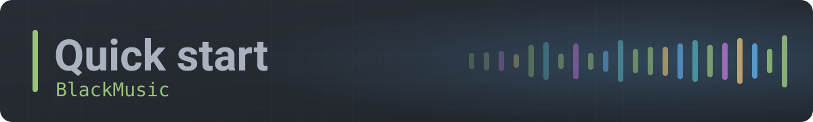

**To use BlackMusic**, download an installer from [GitHub Releases](https://github.com/BlackBlazent/BlackMusic/releases) (see [Downloads](#downloads) for what to expect), open it, then use **Folders** to add the place your music lives.

**To build it yourself**, you need Node 18+, [pnpm](https://pnpm.io), the [Rust toolchain](https://www.rust-lang.org/tools/install) and Tauri's [platform prerequisites](https://v2.tauri.app/start/prerequisites/):

## Installation & Development

### 1. Install dependencies

```bash
pnpm install
```

### 2. Configure environment variables

```bash
cp .env.example .env
```

Edit `.env` and provide credentials only for the services you intend to use. See the **.env.example** and comments in the file for details.

### 3. Run the desktop app

```bash
pnpm tauri:dev
```

### 4. Build the desktop app

```bash
pnpm tauri:build
```

### 5. Mobile development

For setup instructions and native dependency requirements, see [MOBILE.md](./MOBILE.md) and [MOBILE_NATIVE.md](./docs/MOBILE_NATIVE.md).

**Android:**

```bash
pnpm tauri:android:dev

# List connected Android devices
adb devices

# Build a release APK with verbose logs
pnpm tauri android build --apk --verbose
```

**iOS:**

```bash
pnpm tauri:ios:dev
```

*Note: iOS development requires macOS and Xcode.*

### 6. LG webOS

Build the webOS version:

```bash
pnpm build:webos
```

For Android TV, LG webOS, and Apple TV setup and testing instructions, see [TV.md](./docs/TV.md).

`pnpm dev` runs the interface alone in a browser tab for quick layout work (no native features). Build, test and release details are in **[DEVELOPMENT.md](./DEVELOPMENT.md)**.

## Instance Development Scopes

### Building for Mobile

Building the app for mobile requires [**FFmpeg-Kit**](https://github.com/ffmpegkit-maintained/ffmpeg) and a native [**Whisper.cpp**](https://github.com/ggml-org/whisper.cpp) implementation using C/C++.

For general guidance, see [MOBILE.md](./MOBILE.md).

For native integration instructions covering FFmpeg-Kit and Whisper.cpp, follow the guidelines in [MOBILE_NATIVE.md](./docs/MOBILE_NATIVE.md).

For Android-specific build issues, refer to [WHISPER_ANDROID_INTEGRATION.md](./docs/WHISPER_ANDROID_INTEGRATION.md). This guide covers the C++ linker investigation, Kotlin source fix, dependency management, and related build troubleshooting.

## Optional: full-length YouTube audio on mobile (Piped build)

> **Disabled by default.** Android and iOS builds ship without yt-dlp, so YouTube, Last.fm and MusicBrainz results
> fall back to a 30-second Deezer preview or an Audius match. This optional build asks a **Piped** server for the
> full-length audio instead. Piped is a third-party, community-run service that returns a YouTube video's audio stream.
>
> **Do not publish this build on Google Play or the App Store.** Extracting YouTube audio is against YouTube's
> Terms of Service and the stores' policies, and can get an app or developer account removed. Use it only for
> private or sideloaded builds.

### Enable it

1. Open `src/lib/services/streamResolver.ts` and uncomment every section marked `[PIPED-BUILD]`:
   - the two imports at the top (`isMobileOs`, `getPreference`)
   - the helper block between its `START` and `END` lines
   - the Piped step inside `resolveStream`, between its `START` and `END` lines
   - the replacement `throw new Error(...)` line, used **instead of** the active one just above it
2. Optional: point it at your own Piped server by adding this to `.env` (comma-separate several):

   ```bash
   VITE_PIPED_API_URLS=https://your-own-piped-api-host
   ```

   Replace the host with a real Piped API address you control or trust. Do not leave the example value in. If you
   skip this line, the three built-in public servers are tried instead.
3. Rebuild the app. `.env` values are read at build time, so a running dev server or an installed APK will not pick up changes.

### Disable it (store builds)

Re-comment those sections, remove `VITE_PIPED_API_URLS` from `.env`, and rebuild.

### Notes

- Order of lookup: yt-dlp (desktop) → Piped (if enabled) → Deezer 30 s preview → Audius.
- Public Piped servers go offline or get rate-limited often. If playback shows "Couldn't get a stream…", try again or use your own server.
- Desktop builds are unaffected. yt-dlp still runs first.

**Troubleshooting tip:** If you encounter build errors, consult the Android integration guide first for relevant diagnostic steps and fixes.

---

## BlackMusic on TV

BlackMusic is expanding to Android TV, LG webOS, and Apple TV. Android TV supports D-pad navigation and uses the existing Android build, while LG webOS uses a separate web build. Apple TV currently has only a developer scaffold, with its full interface still under development. See doc at **[TV.md](./docs/TV.md)** for details.

**Note:** Android TV and webOS builds have not yet been tested on real TVs. Some platform-specific features remain limited or unavailable.


&nbsp;

## Using it

* **Folders:** add the folders where your music lives. A strip shows the subfolders inside the one you are browsing. Removing a folder removes its tracks from the app, never from your disk.
* **Local:** every track in your watched folders, sortable and filterable.
* **Library:** your music by album, artist, playlist or favorites, plus the maintenance tools (bitrate analyzer, duplicate finder, batch tag editor, format converter and more).
* **Online:** pick a connected service from the sidebar logo and browse its content, or switch to the list view.
* **Home:** your recent listening, "play this week", "play the last 30 days", a highlights timeline and a listening diary.
* **Playground:** the full-screen player, with tools opening as floating panels so nothing resizes beneath you.
* **Settings:** appearance and banner, personalization, language, integrations and API keys, plugins and tools, account, and updates.

&nbsp;

##  Downloads

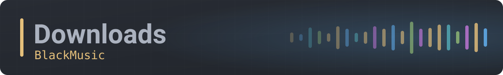

| Where | Link |
| :-- | :-- |
| **GitHub Releases** (primary; **Settings → Updates** checks it) | [Open releases](https://github.com/BlackBlazent/BlackMusic/releases) |
| producthunt.com | [blackmusic-ravensyntha](https://www.producthunt.com/products/blackmusic-ravensyntha?utm_source=other&utm_medium=social) |
| SourceForge | [sourceforge.net/projects/blackmusic](https://sourceforge.net/projects/blackmusic/) |

> **About signing.** Installers are code-signed only when the maintainer's signing certificates are configured in the release workflow. Until then, Windows SmartScreen or macOS Gatekeeper may warn before opening a build. Check that a release page says its installers are signed before sharing it widely.

&nbsp;

##  Platforms

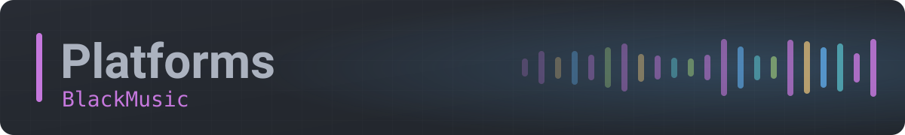

* **Windows, macOS, Linux:** installers on GitHub Releases.
* **Android and iOS:** built from the same code. Setup and limits are in **[MOBILE.md](./MOBILE.md)**. Mobile uses a bottom navigation bar; the mini player, dock mode and the bundled desktop tools are not part of the mobile app.
* **Video and YouTube:** desktop can use `yt-dlp` where the service's terms allow it. Mobile uses the YouTube API for search and playback only, with no downloading.
* **TV and other screens:** an Android TV manifest, remote-control navigation and a webOS package script exist as part of 3.0.0 work; see [docs/TV.md](./docs/TV.md). Apple TV is a starting scaffold only and is not shipped.

&nbsp;

## Configuration

Settings that need a service key are optional; a feature without its key says so and turns itself off instead of failing silently. Keys go in `.env` (copy `.env.example`) or, for your own keys, **Settings → Service API keys**. Never put a real key in a document or an issue. Variables are described in [DEVELOPMENT.md](./DEVELOPMENT.md#environment-variables).

&nbsp;

<!--
## Toolkit

<a href="https://tauri.app/"></a>
<a href="https://reactjs.org/"></a>
<a href="https://www.typescriptlang.org/"></a>
<a href="https://www.rust-lang.org/"></a>
<a href="https://vitejs.dev/"></a>
<a href="https://supabase.com/"></a>

&nbsp;
-->

##  Status

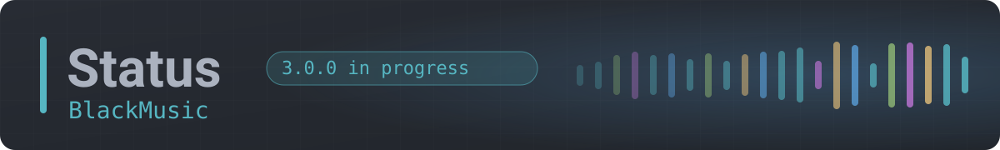

| | |
| :-- | :-- |
| **Shipped (2.2.0)** | Everything listed under [Features](#features). |
| **Shipped (3.0.0)** | Reliability and compatibility fixes (cover-art lookup, audio focus on Android, mobile sign-in, import speed, release signing), a redesigned Settings, equalizer, lyrics upload, new Library and Online views, and optional device sync. |
| **Not available yet** | Apple TV app, iOS home-screen widget. |

The change history is in [CHANGELOG.md](./CHANGELOG.md).
 
&nbsp;

## Security, privacy and limits

* **Your music stays on your device.** BlackMusic never uploads your audio files. The app contains no analytics or advertising SDK (checked in the source).
* **Accounts are optional.** Signing in uses Supabase and a provider you choose; it is only used to identify you in the app. Some features contact third-party services (catalogs, lyrics, artwork, sign-in) only when you use them.
* **Optional sync (3.0.0, in progress)** is designed to send library details only (titles, playlists, favorites, folder names), never audio; songs would move directly between your own devices.
* **Read the details:** [Privacy Policy and Terms](./docs/legal/PRIVACY_POLICY_AND_TERMS.md).
* **Report a vulnerability privately** through [GitHub's private report form](https://github.com/BlackBlazent/BlackMusic/security/advisories/new). Details in [Security.md](./Security.md).
* **Known limits:** some services need keys that not everyone can get; Android only lists audio the system lets the app see.

&nbsp;

##  Contribute

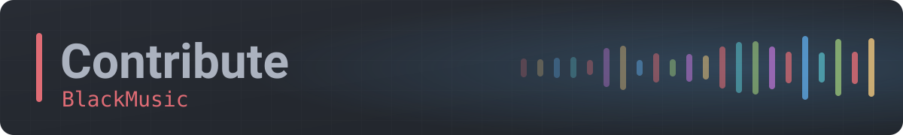

## Get Involved

- **Found a bug, have a feature request, or an idea to share?** [Open an issue](https://github.com/BlackBlazent/BlackMusic/issues/new/choose) and include steps to reproduce the problem, where applicable.
- **Want to contribute?** Start with [contributing.md](./contributing.md) and [DEVELOPMENT.md](./DEVELOPMENT.md). Please also follow our [Code of Conduct](./CODE_OF_CONDUCT.md), [Code of Ethics](./CODE_OF_ETHICS.md), and [Security Policy](./Security.md).

## Top Contribution Priorities

We welcome contributions across all areas of BlackMusic. These are some of the areas where help is especially valuable:

1. **Localization & Language Support**
   - [ ] Add support for more languages.
   - [ ] Improve existing translations and language support.

2. **UI/UX Improvements**
   - [ ] Improve usability, accessibility, consistency, and visual design.

3. **Library & Performance**
   - [ ] Improve music library functionality, organization, and performance.

4. **Platform Support & Testing**
   - [ ] Improve and test the iOS experience.
   - [ ] Improve and test the macOS experience.
   - [ ] Complete and test Android TV support.

5. **Documentation & Examples**
   - [ ] Expand developer and user documentation.
   - [ ] Add practical examples, tutorials, and usage guides.

Every contribution matters, whether it's code, documentation, testing, translations, or feedback. Thank you for helping make BlackMusic better!

&nbsp;

## License

Copyright © 2026 [BlackBlazent](https://www-blackblazent.com.vercel.app). All rights reserved. The repository may be viewed and forked through GitHub; compiling and distributing it as an executable for public or commercial use needs the copyright holder's written permission. See [LICENSE](./LICENSE) for the exact terms.

If BlackMusic is useful to you, try it, tell us what broke, or star the repository. That is all we ask.

&nbsp;

<sub>Last revised: November 2026</sub>
